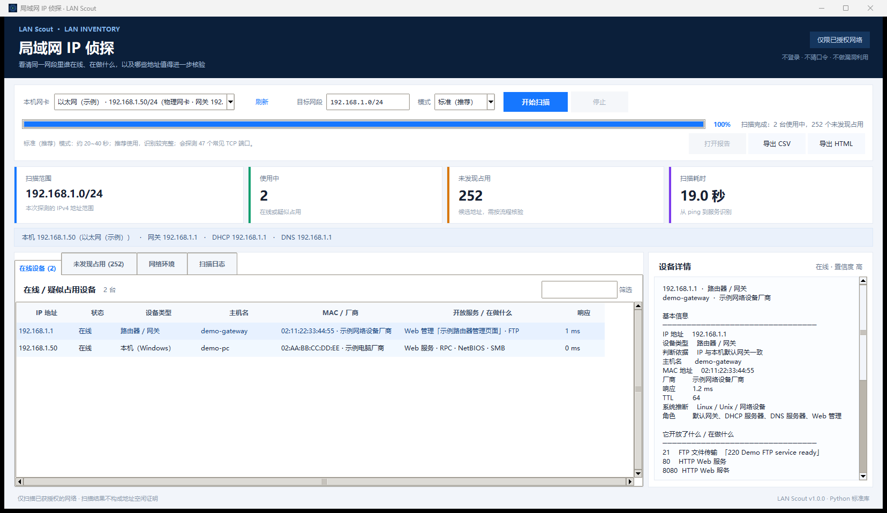
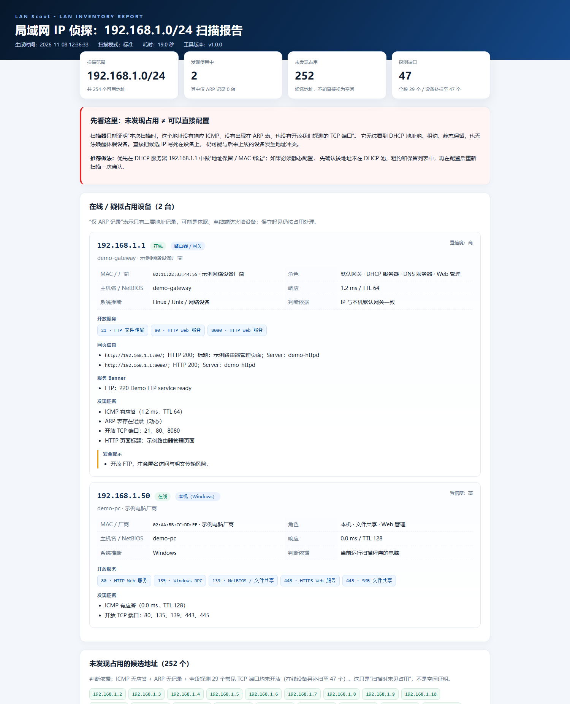

# 局域网 IP 侦探 · LAN Scout

一个运行在 Windows 上的局域网 IPv4 巡网工具：**看清同一网段里哪些地址正在使用、用它的设备是什么、正在提供什么服务，以及哪些地址只是“本次扫描未发现占用”的候选（仍需 DHCP 核对）。**

- 纯 Python 标准库实现，**不需要 pip 安装任何依赖**。
- 提供中文图形界面 + 命令行 + HTML/CSV/JSON 报告。
- 只做普通 ICMP / ARP / TCP 端口探测，不登录设备、不猜口令、不利用漏洞。
- 请只扫描你已获授权的网络。



> 仓库中的界面截图、示例报告均使用脱敏的演示数据；真实内网扫描结果请保存在本机，不要提交到公开仓库。

---

## 一、它能回答什么

### 1. 同网段哪些 IP 已被使用？

通过三层证据交叉判断：

- **ICMP**：普通 ping 是否有应答；
- **ARP**：同网段二层是否出现 MAC 记录，即使设备屏蔽了 ICMP 也能发现；
- **TCP 端口**：设备是否开放常见服务端口，用于发现“不响应 ping”的静默设备。

结果会区分：

| 状态 | 含义 | 是否按占用处理 |
|---|---|---|
| 在线 | ICMP、端口或 ARP 有明确响应 | 是 |
| 仅 ARP 记录 | 只有二层 MAC 记录，可能休眠/离线/被防火墙拦截 | 是（保守处理） |
| 配置地址 | 与本机网关/DHCP/DNS 配置关联但本次未响应 | 是 |
| 未发现占用 | 本次扫描三项证据都没有发现设备 | 否，只是候选 |
| 未发现占用（ARP 未核验） | ARP 查询失败，缺少二层证据 | 否，需重扫或登录 DHCP 核对 |
| 未核验（非直连网段） | 目标不是本机直连网段，只能做三层探测 | 否，不能作为本地配置依据 |

### 2. 正在使用的 IP 在干什么？

对发现的设备做轻量画像：

- 主机名（DNS PTR / NetBIOS / 尝试 mDNS）；
- MAC 厂商（离线 IEEE OUI 数据库）；
- 设备类型推断（路由器、Windows 电脑、打印机、摄像头/NVR、NAS、Proxmox、IoT、手机等）；
- 开放 TCP 端口及其服务含义；
- HTTP/HTTPS 网页标题、Server 头、跳转地址、TLS 证书名称；
- SSH / FTP / SMTP banner；
- TTL / 端口特征推测操作系统或设备类型；
- 发现证据、置信度和安全提示。

### 3. 没被使用的是不是可以直接配置使用？

**不能仅凭扫描结果直接配置。** 扫描器看不到路由器的 DHCP 地址池、租约和静态保留，也无法唤醒休眠设备。

本工具会：

- 给出“本次未发现占用”的候选 IP；
- 在“未发现占用”页对选中 IP 做**配置前核验**（多次 ping + ARP 表 + ARP 请求 + 常见端口）；非直连目标会明确提示无法做二层核验；
- 给出子网掩码、网关、DNS、DHCP 服务器等参考参数；
- 在界面和报告中明确显示风险与推荐流程：**优先用 DHCP 地址保留，而不是直接把 IP 写死。**

非直连目标会显示“未核验（非直连网段）”，ARP 查询失败会显示“未发现占用（ARP 未核验）”，不会伪造二层结论。

---

## 二、快速开始

### 环境要求

- Windows 10 / Windows 11；
- Python **3.10 或更高版本**（自带 Tkinter 即可，无需 pip 安装依赖）；
- 不建议在开启“客户端隔离”的公共 Wi-Fi 上扫描。

### 启动方式

1. 双击 `启动局域网扫描器.bat` 或 `start-lan-scout.bat`；
2. 程序会自动识别本机网卡、IP、子网掩码、网关、DHCP 服务器和 DNS；
3. 确认目标网段（默认是本机所在网段，例如 `192.168.1.0/24`）；
4. 选择“快速 / 标准（推荐）/ 深度”；
5. 点击 **开始扫描**。

如果系统没有把 `pythonw.exe` 放进 PATH，启动器会回退到 `python lan_scout.py` 并保留控制台窗口，便于查看错误信息。

### 使用步骤

1. **看在线设备**：点击任意行，右侧显示设备详情；双击可打开独立详情窗口。
2. **看未发现占用**：切换到“未发现占用 (N)”标签页，选择候选 IP；
3. **配置前核验**：点击“配置前核验选中 IP”，等待约 5 秒左右，查看核验证据和参考网络参数；
4. **导出**：顶部“打开报告 / 导出 CSV / 导出 HTML”；
5. 每次扫描结束会自动在 `reports/` 下保存 HTML 报告和 JSON 原始结果。

### 扫描模式

| 模式 | 适合场景 | 说明 |
|---|---|---|
| 快速 | 日常快速巡网 | 较少端口，约 10~20 秒 |
| 标准（推荐） | 一般家庭/办公网 | 29 个全段发现端口，已发现设备补扫至 47 个，约 20~40 秒 |
| 深度 | 想尽量识别服务 | 55 个常见端口和服务指纹，约 40~90 秒 |

时间会受网段大小、设备数量、网络延迟影响。可在扫描中点击“停止”。

---

## 三、结果怎么读

### 在线 / 疑似占用

- **在线**：有 ICMP 应答或至少一个探测端口开放；
- **仅 ARP 记录**：只拿到了 MAC，可能是休眠设备、关闭了 ICMP 的设备或旧 ARP 记录；保守起见仍视为占用；
- **配置地址**：IP 与本机默认网关/DHCP 服务器/本机地址一致，即使本次未响应也不当作空闲。

### “未发现占用”不是“空闲证明”

下列情况都可能造成漏检：

- 设备正在休眠或关机，但 DHCP 租约还保留着这个 IP；
- 设备的防火墙丢弃 ICMP，同时没有开放我们探测的端口；
- 无线 AP 开启了客户端隔离；
- 目标网段不是本机直连的二层网段（工具会提示，ARP 失效）；
- 路由器 DHCP 地址池或静态保留中已经占用了该地址；
- 我们只探测 TCP，不探测 UDP 服务（例如部分 SNMP、mDNS、DHCP 服务）；
- ARP 查询本身失败或被安全软件拦截时，二层证据会缺失；报告会明确标为“ARP 未核验”，而不是“未发现占用”。

因此，报告里所有“未发现占用”都写作“候选地址”，非直连目标则标为“未核验（非直连网段）”。

---

## 四、安全启用一个 IP 的推荐流程

1. **登录 DHCP 服务器**（通常是网关，例如 `192.168.1.1`）查看地址池起止范围；
2. 查看当前租约列表和静态保留列表；
3. 找到地址池之外、且没有保留记录的地址；
4. **优先做 DHCP 地址保留**：按设备 MAC 绑定固定 IP，由 DHCP 统一管理；
5. 如果必须静态配置：
   - 确认不在地址池内；
   - 使用正确的子网掩码、网关、DNS；
   - 在资产表记录 IP / MAC / 设备位置；
   - 配置完成后再运行一次本工具验证。
6. 不要在扫描结果里随手挑一个地址就写死；设备休眠后唤醒，可能就会出现 IP 冲突。

---

## 五、命令行用法

不启动图形界面，适合脚本或批量巡网：

```powershell
# 查看本机网卡
python lan_scout.py --list-interfaces

# 扫描自动识别的本机网段，输出 HTML 到默认 reports/
python lan_scout.py --cli

# 指定网段和模式
python lan_scout.py --cli --target 192.168.1.0/24 --mode standard --verbose

# 同时导出 HTML、CSV、JSON
python lan_scout.py --cli -t 192.168.1.0/24 -m deep `
  --html reports/scan.html --csv reports/scan.csv --json reports/scan.json
```

参数：

```text
--cli / --target / -t / --mode / -m (quick|standard|deep)
--html / --csv / --json / --verbose / -v
--list-interfaces / --version
```

支持的目标格式：

```text
192.168.1.0/24
192.168.1.10-50
192.168.1.10-192.168.1.50
192.168.1.10
```

当前限制最多 4096 个地址；建议单次不超过 /20。

---

## 六、输出文件

每次图形扫描结束自动生成：

```text
reports/
  局域网扫描报告_<网段>_<时间>.html   # 自包含 HTML，可离线打开
  局域网扫描报告_<网段>_<时间>.json   # 完整结构化结果
```

手动导出：

- **HTML**：适合打印/分享，包含在线设备卡片、候选空闲 IP、配置安全说明；
- **CSV**：包含已占用、未发现占用、网络/广播地址三类行，UTF-8 BOM，Excel 打开中文不乱码；
- **JSON**：完整字段，适合二次处理。



仓库中的 `docs/example-report.html` 是脱敏演示数据生成的示例报告；实际扫描生成的报告只保存在本机 `reports/` 目录，不随仓库上传。

---

## 七、识别原理（轻量、非侵入）

- **ICMP**：调用 Windows IP Helper API `IcmpSendEcho`，无需管理员权限，比启动大量 `ping.exe` 更快；
- **ARP**：读取 `arp -a`；配置前核验时使用 `SendARP` 发一次标准 ARP 请求；
- **TCP**：`asyncio` 并发 `connect` 常见端口，只建立连接不发送利用性数据；
- **HTTP/HTTPS**：GET `/`，解析标题、Server、Location、证书 CN；
- **banner**：读取 SSH/FTP/SMTP/Telnet 服务欢迎信息；
- **主机名**：DNS PTR + NetBIOS `nbtstat -A` + 轻量 mDNS 查询（部分设备/网络可能不响应 mDNS）；
- **厂商**：离线 OUI 数据库（IEEE / Wireshark manuf，见 `data/oui.json.gz`）。

工具**不会**：

- 尝试登录设备或猜解口令；
- 发送漏洞利用或畸形包；
- 修改扫描设备或被扫描设备的配置；
- 读取设备文件。

---

## 八、项目结构

```text
lan-scout/
├── 启动局域网扫描器.bat        # 中文名启动器
├── start-lan-scout.bat         # 英文名启动器
├── lan_scout.py                # 入口：GUI / CLI
├── lanscout/
│   ├── gui.py                  # 中文 Tkinter 界面
│   ├── scanner.py              # 扫描编排、空闲判定、配置建议
│   ├── discovery.py            # ICMP / ARP / TCP 探测
│   ├── fingerprint.py          # HTTP/banner/主机名/设备画像
│   ├── netconfig.py            # 网卡识别、目标解析
│   ├── report.py               # HTML / CSV / JSON 导出
│   ├── models.py               # 数据模型
│   └── oui.py                  # OUI 厂商查询
├── data/oui.json.gz            # 离线 OUI 数据库
├── tests/test_core.py          # 无网络单元测试
├── docs/                       # 截图
└── reports/                    # 自动报告
```

---

## 九、开发与测试

```powershell
cd D:\LinuxWork\lan-scout
python -m unittest discover -s tests -v
```

测试覆盖：目标解析、网段直连判断、服务标签、OUI、HTML 转义、CSV 导出等，不访问网络。

界面技术：Python 3.10+ / Tkinter / ttk。无第三方依赖。

---

## 十、常见问题

**Q：扫描结果为空？**  
确认目标网段与本机网卡在同一二层网络；检查无线 AP 是否开启客户端隔离；尝试“深度”模式；确认设备没有休眠。

**Q：为什么要扫描这么多端口？是不是入侵？**  
TCP connect 只是确认端口是否开放，不进行登录或利用。请仅用于已获授权的网络。部分安全软件可能对端口扫描行为发出提示。

**Q：为什么“配置前核验”要等几秒？**  
对一个确实空闲的地址发 ARP 请求时，Windows 通常需要约 3~4 秒才能确认无应答，这是正常现象。

**Q：为什么只显示部分端口？**  
工具探测的是常见端口集合，不是全端口 1-65535 扫描；未探测的端口不代表不存在服务。`--mode deep` 会覆盖更多端口。

**Q：能查出路由器 DHCP 里保留了哪些地址吗？**  
不能通用地读取。不同品牌路由器没有统一的只读接口，工具会提示你登录 DHCP 服务器人工核对。这也是“候选地址不能直接配置”的核心原因。

**Q：报告里的 MAC 厂商为空？**  
可能是随机 MAC、虚拟机 MAC 或 OUI 数据未收录；设备仍可能正常在线。

---

## 十一、安全声明

本工具仅用于**你拥有或已获得明确授权的网络**。请遵守当地法律法规和网络管理制度。  
未发现占用的扫描结果不是空闲证明，直接静态配置可能导致 IP 冲突；推荐使用 DHCP 地址保留。

OUI 数据来源：IEEE 注册的 MAC 地址块 / Wireshark `manuf` 数据。
